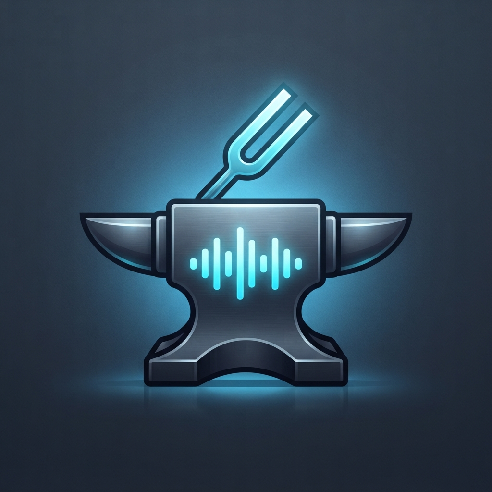
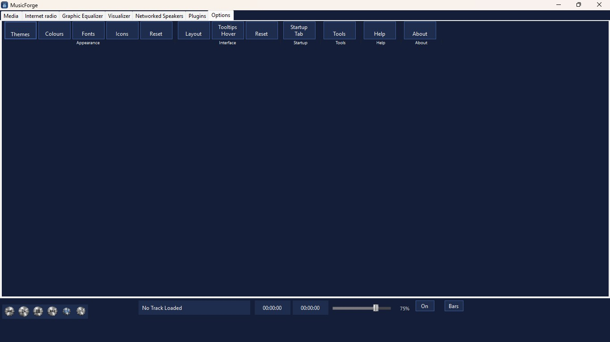
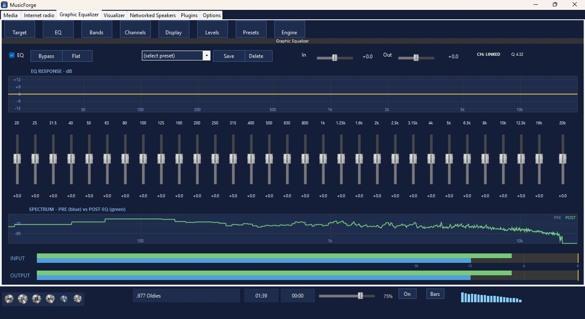
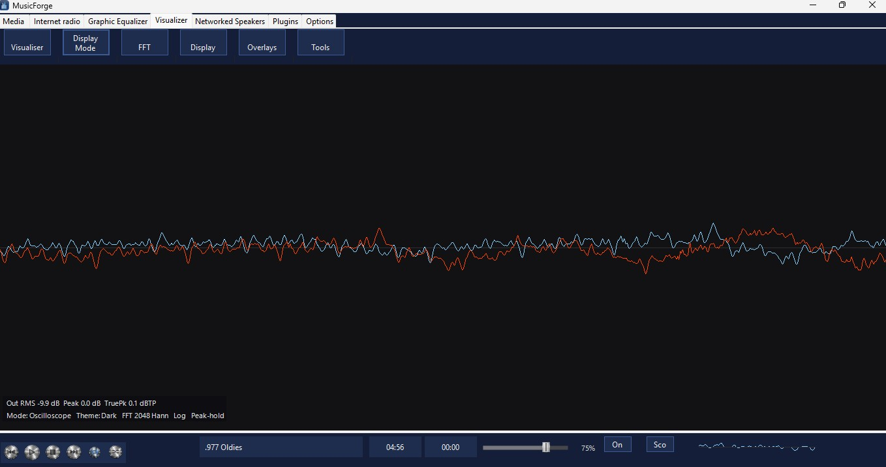
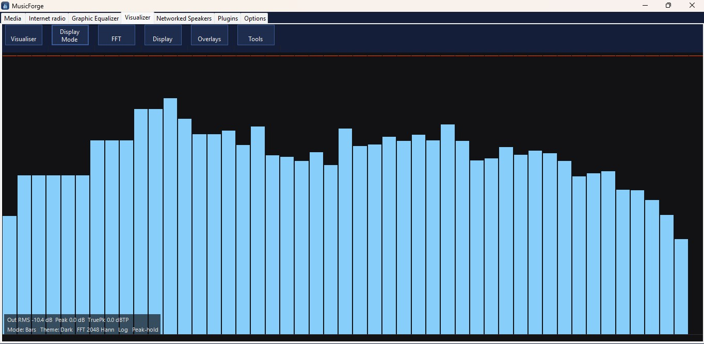
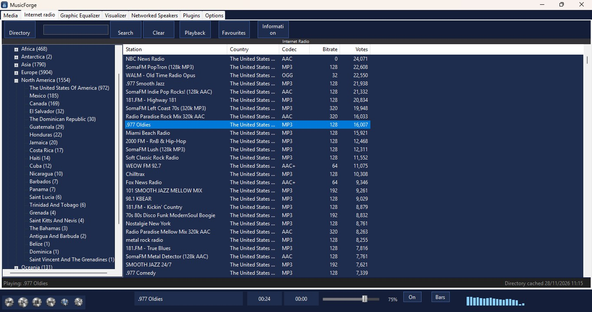
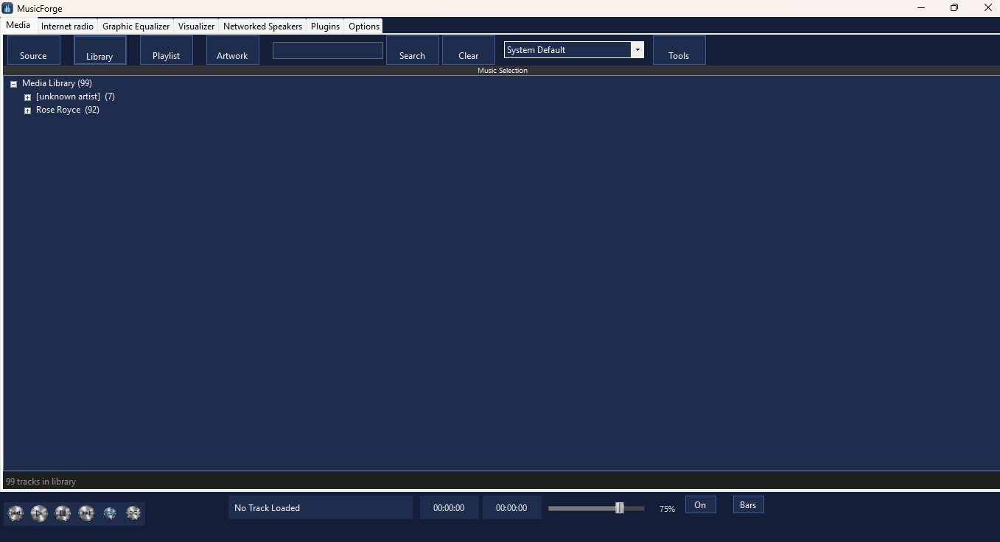
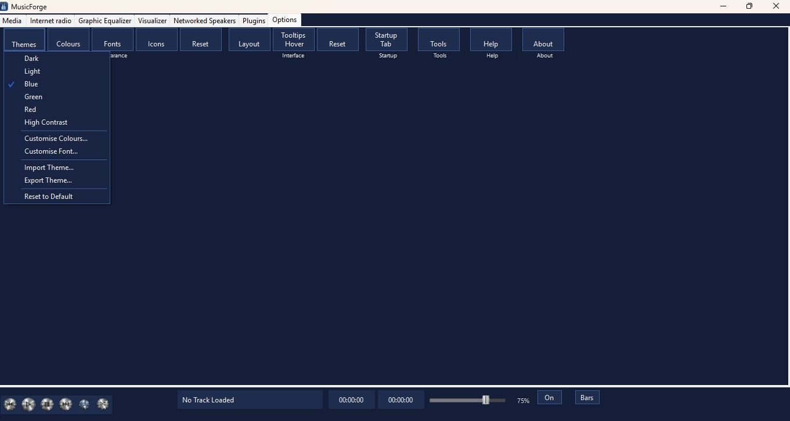

<p align="center">
  
</p>

<h1 align="center">MusicForge</h1>

<p align="center"><b>A music player for people who actually listen.</b><br/>
Built for audiophiles and world-music explorers — a 31-band studio-grade EQ,<br/>
real-time spectrum analysis, and thousands of internet radio stations<br/>
from every corner of the globe. Powered by a real audio engine,<br/>
not a skin over the Windows media library.</p>

## See it

<p align="center">
  
</p>

<table>
  <tr>
    <td width="50%"></td>
    <td width="50%"></td>
  </tr>
  <tr>
    <td></td>
    <td></td>
  </tr>
  <tr>
    <td></td>
    <td></td>
  </tr>
</table>

More views: [mini visualiser](docs/screenshots/mini-visualizer.jpg) ·
[display modes](docs/screenshots/visualizer-display-mode.jpg) ·
[internet radio](docs/screenshots/internet-radio.jpg) ·
[media sources](docs/screenshots/media-source-search.jpg) ·
[media tab](docs/screenshots/media-tab.jpg)

## Why MusicForge

### Built for ears that notice
- **31-band graphic equaliser** — ISO 1/3-octave bands, ±15 dB per band, adjustable Q, per-channel unlinking
- **Minimum *and* linear-phase modes** — linear phase keeps transients coherent for mastering-grade correction; minimum phase keeps latency low
- **True-peak and BS.1770 loudness analysis**, plus offline EQ rendering to bake your curve permanently into a file
- Honest DSP — filters you can measure on the spectrum display, not "magic enhancer" marketing

### The world, on tap
- **Internet radio** — thousands of stations: jazz from New Orleans, rai from Algiers, qawwali from Lahore, field recordings from the Amazon
- Graceful station handling — a dead stream gets flagged cleanly instead of hanging your player
- Curate stations alongside your local library

### Your library, your speakers
- Fast local library — playlists, smart search, track properties, artwork
- **Stream to the rest of your home** — AirPlay, Chromecast, Sonos and DLNA network speakers
- Output selection that **follows Windows default-device changes** — plug in headphones mid-track and the music follows you

## Features

- **Media library** — persistent folder/drive sources, recursive scanning, album/track browsing, artwork tracking, playlists with preserved order
- **Internet radio** — thousands of stations, favourites, now-playing metadata, same engine playback path as local files
- **Graphic equaliser** — 31-band ISO third-octave EQ with minimum/linear phase modes, factory + user presets, import/export
- **Visualiser** — real-time spectrum, waveform, spectrogram and meter displays with themes and plugins
- **Plugins** — CLAP native plugin hosting and managed .NET plugins injected into the playback chain
- **Networked speakers** — discover and stream to speakers around your LAN, synced with local output
- **Fully themeable UI** — colour presets, per-control colours, fonts, density, tooltips/hover, theme JSON import/export, persisted across sessions
- **Tools** — audio conversion/export, track tag editing, ReplayGain, MIDI device test, library backup/compact

## Download

Prebuilt installer for Windows x64 is available on the [Releases](../../releases) page —
self-contained, ~55 MB, no dependencies, no account required, no telemetry.

## Tech stack

- C# / .NET 10, Windows Forms
- SQLite (Microsoft.Data.Sqlite) for library, playlists, radio, themes and settings
- TagLibSharp for metadata, NAudio for WASAPI
- AudioForge engine components (`src/Sound Engine/`)

## Build

Requires the .NET 10 SDK on Windows.

```powershell
dotnet build AudioForge.sln
```

Run the player:

```powershell
dotnet run --project src/UI/MusicForge.UI.csproj
```

## Repository layout

```
src/
  UI/                              MusicForge WinForms app
  Sound Engine/                    AudioForge engine components (playback, DSP, streaming, plugins)
  AudioForge.SoundEngine/          Engine compatibility layer
  AudioForge.NetworkSpeakers/      Network speaker services
  AudioForge.Visualizer.Contracts/ Visualiser plugin contracts
  AudioForge.VisualPlugins.Samples/ Sample visualiser plugins
  SpeakerForge/                    Network speaker engine
installer/                        Inno Setup installer script
Specs/                            Design specifications
```

## License

Proprietary — see [LICENSE](LICENSE). The MusicForge application source is
provided for personal evaluation and non-commercial use only; distributed
binaries are governed by the End User Licence Agreement shown at install.
The bundled **AudioForge SoundEngine** and **SpeakerForge** components
remain MIT-licensed — see their respective repositories.
